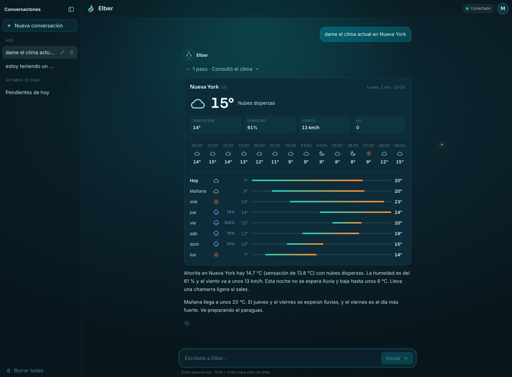

<p align="center">
  
</p>

<h1 align="center">Elber</h1>

<p align="center">A personal, Jarvis-like assistant: a chat with Claude that learns new skills over time.</p>

<p align="center">
  
</p>

## What it is

Elber is a learning project for building AI agents. You talk to it in a web chat. Behind the chat is a Claude agent that answers in real time and can use a growing set of *skills*: tools for real things like the weather, your notes or this repository's issues.

It runs locally on my machine for my own use. It is not deployed anywhere.

## What it can do

- **Chat with streaming answers**, and conversation history (rename, delete). The interface is in Spanish, and Elber answers in whatever language you write in.
- **Search the web and read pages**, citing its sources inline.
- **Weather**: current conditions, the next hours and days, and official alerts, shown as a card. Without a place, it uses your device's location.
- **Long-term memory** in an [Obsidian](https://obsidian.md) vault, all plain Markdown:
  - a profile of what it knows about you, which it reads before every answer;
  - a to-do list;
  - notes for ideas and projects, linked to each other.
- **Diary**: a separate section where Elber asks about your day, one question at a time, and, once you approve its summary, saves it as that day's entry in `Elber/Diario/` of the vault (mood, topics and people included). The regular chat has no access to it.
- **Voice calls**: tap the phone in the chat (or the diary) and talk. The browser turns your voice into text, and Elber answers out loud with an [Amazon Polly](https://aws.amazon.com/polly/) voice, a sentence at a time as the answer streams in. The conversation stays in the chat.
- **Bug reports**: tell Elber about a bug in Elber. It asks what it needs to know, one question at a time, shows you a draft, and opens a GitHub issue once you approve it.

## Stack

| | |
|---|---|
| **Backend** (`backEnd/`) | Node 24, TypeScript, Express 5, Socket.IO, [Claude Agent SDK](https://docs.claude.com/en/api/agent-sdk/overview), Firebase Admin (Auth + Firestore), Zod, Vitest |
| **Web** (`web/`) | React 19, Vite, React Router 7, Firebase Auth, socket.io-client |

These are two independent npm projects.

## Architecture

```
web (React) ──Socket.IO /chat──▶ chat module ──▶ Claude agent
     │                                             │
     └──REST /api/v1──▶ users, chat history        └─ MCP server "elber" ──▶ skills: weather, memory, bugs
```

- **Modular monolith.** The backend is split into modules (`chat`, `users`, `notifications`, `weather`, `memory`, `bugs`, `journal`, `voice`). Each one follows clean architecture (`domain` → `application` → `infrastructure` / `presentation`). Modules never import each other: they talk through an event bus. [dependency-cruiser](https://github.com/sverweij/dependency-cruiser) enforces these rules in CI.
- **Skills are modules.** Each skill exports its tools through a small, framework-agnostic contract. The chat serves them to the agent through an in-process MCP server. A tool can ask the device for its location, or show a *widget* (the weather card, the issue card) that the web renders next to the answer.
- **A locked-down agent.** The agent only has web search, web fetch and Elber's own tools. It has no shell and no file access, and it ignores any local Claude configuration.
- **Real-time chat.** Answers, tool steps, sources and widgets stream over Socket.IO, authenticated with a Firebase ID token. Conversations are stored in Firestore.

## Running it locally

You need Node 24 (see `.nvmrc`) and:

- a **Firebase** project with Authentication (email/password) and Firestore, plus a service account key;
- a **Google Workspace** account to send email (password resets), via the service account with domain-wide delegation;
- an **Anthropic** API key;
- an **OpenWeather** API key (One Call 3.0);
- an **Obsidian** vault folder for the memory;
- an **AWS** IAM user allowed only `polly:SynthesizeSpeech`, for the voice in calls;
- a fine-grained **GitHub** token with *Issues: read and write* on the repository, for bug reports.

```bash
# Backend: http://localhost:3000
cd backEnd
cp .env.example .env   # fill it in: it is validated at startup
npm install
npm run dev
```

```bash
# Web: http://localhost:5173
cd web
cp .env.example .env.local   # Firebase web config and the API URL
npm install
npm run dev
```

To work on the chat UI without the backend, set `VITE_CHAT_MOCK=true` in `web/.env.local`. The chat then answers with a canned demo.

### With Docker

Fill in `backEnd/.env` and `web/.env.local` as above, put the service account key at `backEnd/creds/service-account.json`, then:

```bash
cp .env.example .env   # the Obsidian vault's path on this machine
docker compose up -d --build
```

The app is at http://localhost:5173, on the same ports as `npm run dev`. The vault is mounted into the backend. The agent's sessions live in the `agent-sessions` volume. Vite bakes the `VITE_*` variables in at build time, so after changing `web/.env.local`, rebuild with `--build`.

### Checks

```bash
# backEnd/
npm run lint && npm run lint:arch && npm run typecheck && npm test

# web/
npm run lint && npm run build
```

GitHub Actions runs the same checks on every pull request.
